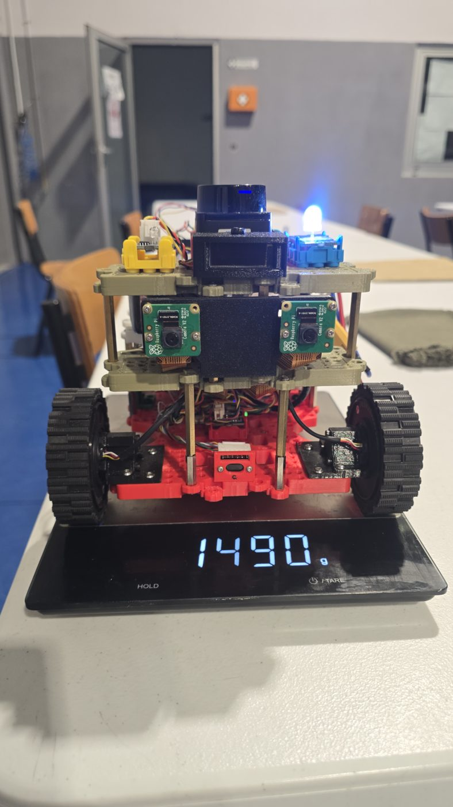

# Learn2Race – Prototype B

Prototype B is the teaching and mapping platform of the Learn2Race project. It uses the same software architecture as the racing robot (Prototype A) for a different purpose: driving by gamepad from a PC, lidar SLAM, autonomous room exploration, stereo depth and short-range obstacle sensing. A Raspberry Pi 5 runs ROS 2 Jazzy, and an ESP32 on a Waveshare DDSM Driver HAT drives two hub motors over micro-ROS.

<p align="center">
  
</p>

## Hardware

| Part | Detail |
|---|---|
| Computer | Raspberry Pi 5, Ubuntu 24.04 Server, ROS 2 Jazzy |
| Motor controller | ESP32 on the Waveshare DDSM Driver HAT, micro-ROS over the Pi header UART (`/dev/ttyAMA0`, 921 600 baud) |
| Motors | 2 × DDSM210 hub motors (73.9 mm wheels), RS-485 bus |
| Lidar | LDROBOT LD06/STL-06P, 10 Hz |
| Cameras | 2 × Raspberry Pi Camera v2 (IMX219), level, 63 mm baseline |
| Ranging | 3 × VL6180X time-of-flight sensors (front, left, right) behind a PCA9548A I2C multiplexer |
| IMU | Grove LSM6DS3 |
| Status LED | Grove Chainable RGB LED (P9813) on GPIO 5/6 |
| Size and mass | 228 × 188 × 177 mm (with cameras), 1490 g |

The software also supports Sharp IR, ultrasonic and ToF050C rangers, but none of these is fitted on Prototype B.

## Repository layout

| Path | Contents |
|---|---|
| [`firmware/`](firmware/README.md) | ESP32 firmware (PlatformIO, micro-ROS): DDSM motor bus, odometry, command watchdog; stereo calibration target in `firmware/calibration/` |
| [`learn2race_ws/`](learn2race_ws/README.md) | ROS 2 Jazzy workspace that runs on the Pi 5 |
| [`tools/`](tools/) | `robot.sh` (run helper), `udp_teleop.py` (receives the PC gamepad) |
| [`docs/references.md`](docs/references.md) | References cited in the code headers as `[Rnn]` |
| [`photos/`](photos/) | Photographs of the robot |

## Documentation

- [INSTALL.md](INSTALL.md): preparing the Raspberry Pi 5, building the workspace and flashing the ESP32.
- [USAGE.md](USAGE.md): driving, mapping, autonomous exploration, the packages and calibration.

## Quick start (robot already installed)

```bash
ssh learn2race@<robot address>
~/robot.sh slam            # base + SLAM; drive with the gamepad from the PC
~/robot.sh save room_1     # save the map to ~/maps/room_1
~/robot.sh explore 180     # map on its own for 3 minutes
~/robot.sh stop
```

The PC side (gamepad over UDP, RViz) is in the **Learn2Race-PC-Control** repository.

## Author

Ruben Pereira, ISEP – Instituto Superior de Engenharia do Porto (MSc dissertation, 2026).
